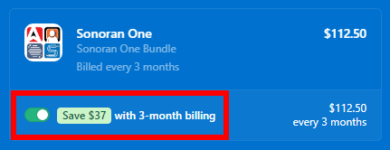

# Pricing FAQ

Additionally, you can get **25% off** if you choose to purchase CAD, CMS, Radio, or Sonoran One as a **quarterly** subscription (available at Stripe checkout).

### Looking to compare plans?

[View our pricing page!](https://sonorancad.com/pricing)

### Looking to purchase a plan?


[create-and-manage-a-subscription.md](create-and-manage-a-subscription.md)


### How do I change what community my subscription is applied to?

At any time with an active subscription (including canceled subscriptions that are still active) you may change what community is benefiting from the subscription.

Simply change the [community ID](../../tutorials/getting-started/finding-your-community-id-and-authentication-code.md) on the active subscription to a new one.


[create-and-manage-a-subscription.md](create-and-manage-a-subscription.md)


### How do I cancel, upgrade, or downgrade my subscription?

You can cancel, upgrade, or downgrade your subscription at any time using the payment center.


[create-and-manage-a-subscription.md](create-and-manage-a-subscription.md)


### Are subscriptions a one-time payment, or monthly?

Sonoran CAD offers monthly and quarterly subscriptions, plus a $499 USD one-time CAD Pro Lifetime license. Lifetime covers the same CAD Pro features and Pro usage limits for the operational lifetime of the hosted Sonoran CAD service. We offer multiple subscription levels at different price ranges. You can [compare our plans ](https://sonorancad.com/pricing)to see what works best for your community.

By choosing a **quarterly subscription**, you are given a **25% discount**. Simply select the **3-month billing** option at checkout and the discount will automatically be applied!

<figure><figcaption>
Sonoran Software - Quarterly Plan
</figcaption></figure>

Monthly subscriptions are renewed one month after the start date, and quarterly subscriptions are renewed three months after the start date. You will receive an email from Stripe a few days before you are charged again. This way, you aren't charged again without prior notice.

### Can I purchase a lifetime or yearly subscription?

CAD Pro Lifetime is a **$499 USD one-time purchase**, plus any applicable taxes shown at checkout. It is non-transferable and belongs to the original purchasing account. Apply it to **one community you currently own** and move it to another community you own at any time, with no cooldown and no game restriction. Communities you do not own, or that already have another active plan, cannot be selected.

Before transferring community ownership, unassign the Lifetime license in CAD Billing. The community loses that license's Pro coverage; the license stays on the purchaser's account. Buying Lifetime does not automatically cancel any other subscription.

Lifetime purchases are non-refundable except as required by law; the voluntary 48-hour guarantee does not apply. Read the [CAD Pro Lifetime Agreement](https://docs.sonoransoftware.com/policy/policy/cad-pro-lifetime-agreement) before purchasing.

Yearly subscriptions are not offered. Monthly and quarterly subscriptions remain available.

### What payment methods are accepted?

We accept all major credit or debit cards through the in-app payment center. All payment processing is handled via Stripe.

### What happens if my subscription expires, or I unassign Lifetime? Will I lose my data?

If your subscription expires or you remove a Lifetime license without other valid paid coverage, your CAD will automatically be downgraded to the free version. Your data will not be lost, but you will lose access to the additional customization or integration features that were included with your paid plan.

_Communities with no active logins for 30 days will be automatically removed._

### I purchased expert installation, how do I activate this?

If you've purchased [expert installation](/broken/pages/iCw94PXH1OrhFo1aOyEn), simply reach out to our [customer support team](https://support.sonoransoftware.com).

### Refund and Purchase Policy

For more information on our refund and purchasing policy, click [here](../../other/policy/refund-and-purchase-policy.md).
