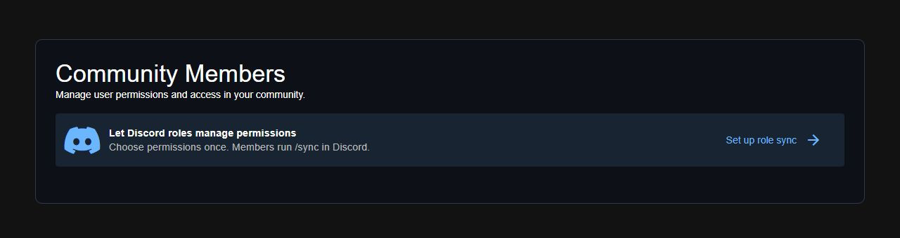
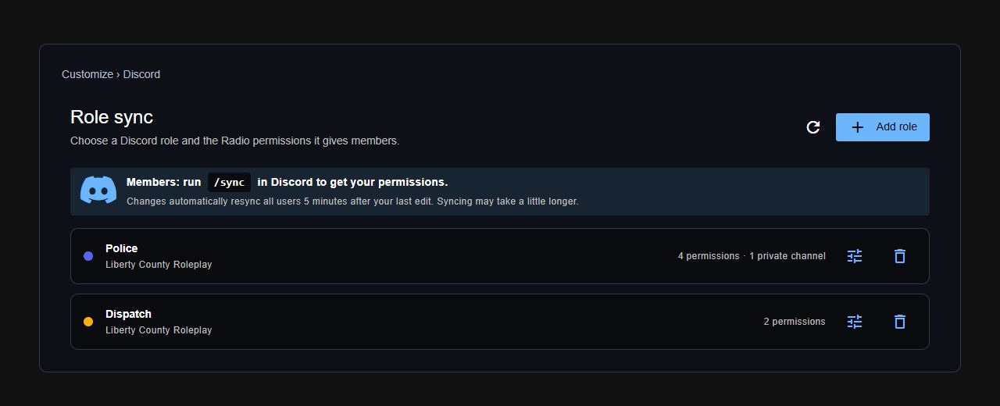
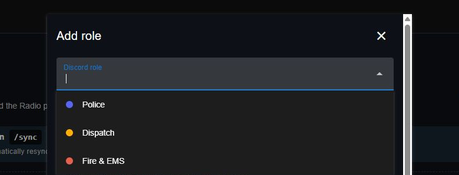
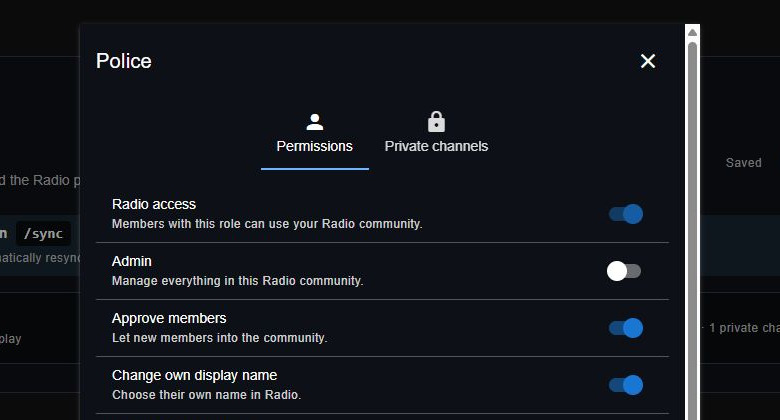
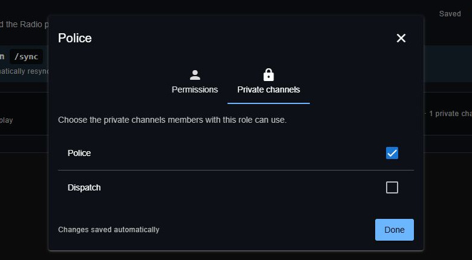

# Role sync

Give members Radio permissions through their Discord roles.

## 1. Connect Discord

Follow [Connect your server](../discord-bot-integration.md), then open **Customize > Discord**. You can also select **Set up role sync** in **Members**.

<figure><figcaption>
Open role sync from the Members panel.
</figcaption></figure>

<figure><figcaption>
Each role shows its Discord server and assigned permissions.
</figcaption></figure>


If this community uses Sonoran CMS, configure [Radio permissions in CMS](https://docs.sonoransoftware.com/cms/integration-capabilities/sonoran-radio-sync). Radio role mapping is disabled for communities managed by CMS.


## 2. Add a role

1. Select **Add role**.
2. If more than one Discord server is connected, choose the correct server.
3. Type a role name and select it. The dot beside its name shows its Discord role color.
4. Choose what members can do under **Permissions**. Scroll to see all permissions.
5. Under **Private channels**, choose the channels members can use.
6. Wait for **Changes saved automatically**, then select **Done**.

<figure><figcaption>
Type to find a Discord role.
</figcaption></figure>

<figure><figcaption>
Choose what members with this role can do.
</figcaption></figure>

**Radio access** is included with every mapping. A matching role can approve a pending member even when no extra permissions are selected.

<figure><figcaption>
Give this role access to specific private channels.
</figcaption></figure>

## 3. Sync members

1. Members join your Radio community.
2. Members run `/sync` in Discord. If their account needs linking, the bot shows them how.

After a mapping changes, all linked members automatically resync **5 minutes after your last edit**. Finishing the sync may take a little longer.

Once a member is linked, adding or removing their Discord roles automatically updates their Radio permissions. They do not need to run `/sync` after each role change. The five-minute delay applies to mapping edits.

Members receive the combined permissions and private channel access from all their mapped roles across connected Discord servers. Sync replaces manually assigned Radio permissions and private channel grants. The community owner keeps full access.

## Edit or remove a mapping

1. Select **Edit permissions** beside a role to change its permissions or private channels. Changes save automatically.
2. Select **Delete role mapping** beside a role to remove its mapping. This removes the mapping, not the Discord role.

