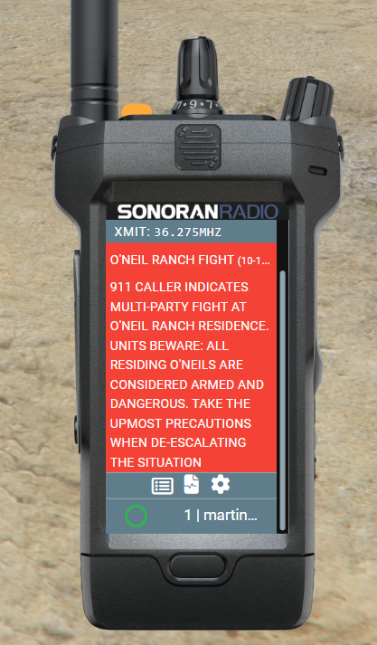

# Sonoran CAD Integration

Connect Sonoran Radio to CAD to sync desktop overlay panic alerts with your CAD unit. The FiveM CAD plugin also provides call information, tower blips, and display name sync for the in-game radio.

## Desktop Overlay Panic

The desktop overlay uses the CAD API link configured in **Customize > Dispatch AI** for the Radio server you connect to. Configure this link even if you only want panic synchronization; **Dispatch AI Enabled** can remain off.

1. In CAD, open **Admin > Advanced > In-Game Integration > Web API** and copy the community ID and API key.
2. In CAD, open **Admin > Customization > Servers** and note the server ID.
3. In Radio, open **Customize > Dispatch AI** and select the Radio server used by your overlay.
4. Under **Link Sonoran CAD**, enter the CAD community ID, API key, and server ID. Leave each field to save it.
5. Sign in to Radio and CAD with the same Sonoran account, and go on duty in the linked CAD server.

Press the overlay's **Panic** button to activate panic in Radio and CAD. Press it again to clear both. Clearing your panic through Radio also clears it in CAD.

Frame controls are managed in **Customize > Overlay > Manual**. If a frame has no panic control, use **Add Button > Panic**, position it over the intended button, and select **Save changes**. Custom screens can also include a Panic element. See [Radio Overlay](../usage/desktop-overlay.md#create-a-custom-overlay) for frame editing.

If Radio panic activates but CAD does not update, check the selected Radio server's CAD link, the CAD server ID, and that the same account has an on-duty CAD unit. The overlay displays an error when CAD synchronization fails.

For voice commands using the same CAD link, follow [Dispatch AI setup](dispatch-ai.md#common-setup).

## FiveM Sonoran Radio CAD Plugin

For the FiveM in-game radio, [enable the `sonrad` (Sonoran Radio) submodule in your CAD resource](https://info.sonorancad.com/integration-plugins/in-game-integration/fivem-installation/available-plugins/sonoran-radio-sonrad).

## FiveM Integration Features

### Panic Toggle

CAD Panic Toggle

Triggering your Sonoran Radio panic (by pressing the yellow button at the top of the radio) will also toggle your panic status in Sonoran CAD.

### Dispatch Call Information

Dispatch Call Information

When attached to a Sonoran CAD dispatch call, the radio will display a red call info box and set the top status bar to red. Click the call title to expand and collapse the information.

.png>) 

### Live Map Blips

Live Map Radio Tower Information

Sonoran Radio towers will be displayed on the CAD live map.

Select one of the blips to view it's repeater type and health.

.png>)

## Display Name Sync

CAD To Radio Display Name

Automatically set your radio's display name based on your CAD unit information.

In the `sonorad` submodule's configuration file, set `config.syncRadioName.enabled` to true and customize the formatting in `config.syncRadioName.nameFormat`.

.png>)

